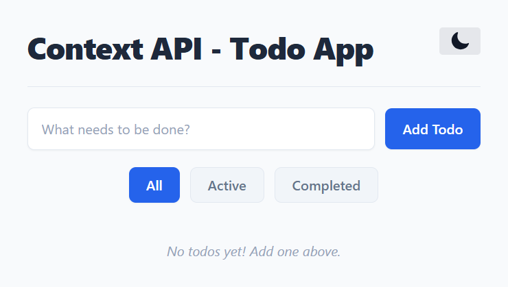
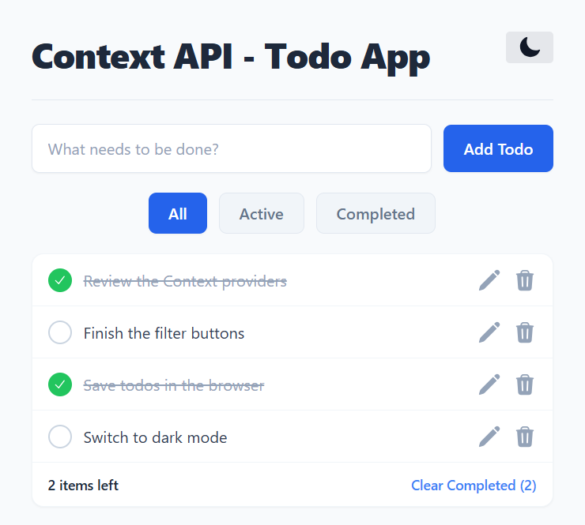
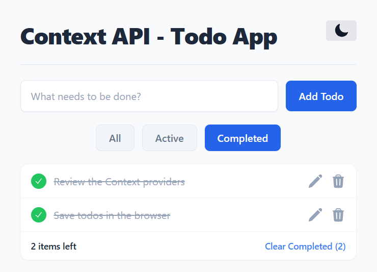
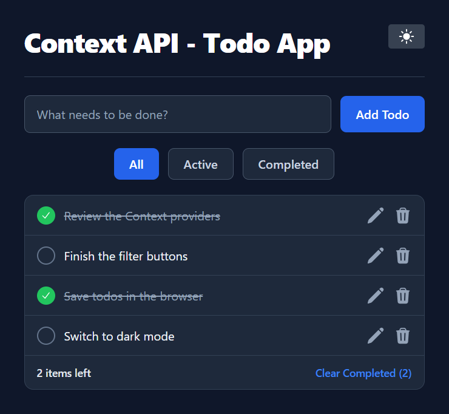

# Context API Todo App

A todo list that shares its data through React Context. Add items, mark them done, edit or delete them, and filter the list.

## Description

The todos and the light or dark theme stay in the browser after a refresh. The list screenshots use sample todos. A fresh visit starts with an empty list.

* Add a todo from the text field. A blank entry is left off the list.
* Mark a todo complete or active
* Edit a todo. Enter saves, and Escape cancels. A blank edit is left unchanged.
* Delete a todo
* Filter by All, Active, or Completed. The filter starts on All each time the page loads.
* Clear every completed todo
* Switch between light and dark

Todos are saved in the browser under the key `todos`. The theme is saved under `theme`.

Three providers wrap the app in `src/main.tsx`:

* **Theme** keeps the page light or dark
* **Todos** keeps the list and the add, toggle, edit, delete, and clear actions
* **Filter** keeps All, Active, or Completed

Each component reads the context it needs with `useContext`.

## Screenshots

### Empty list

The page asks for a todo and starts on the All filter.



### All todos

Completed items are crossed out. The footer counts how many are still left, and Clear Completed shows how many are done.



### Completed filter

Only finished todos stay on screen. The item count still means how many are left to do.



### Dark mode

The moon button switches the page to dark and becomes a sun. That choice is saved.



## Getting Started

### Dependencies

* Node.js and npm
* React 19, TypeScript, Vite, and Tailwind CSS

### Installing

```bash
npm install
```

### Executing program

```bash
npm run dev
```

Open the URL Vite prints, usually `http://localhost:5173/`.

| Command | What it does |
| --- | --- |
| `npm run build` | Type-check and build for production |
| `npm run preview` | Serve the production build |
| `npm run lint` | Run ESLint |

## Help

A blank add is left off the list. A blank edit is left unchanged. The filter starts on All each time the page loads.

## Authors

[Mamadou Moussa Balde](https://www.linkedin.com/in/2mb/)

## Version History

* Current local run
    * Vite, usually `http://localhost:5173/`
    * Empty list, four todos, the Completed filter, and dark mode were captured

## License

This folder does not include a `LICENSE.md` file.

## Acknowledgments

* [React](https://react.dev/)
* [Vite](https://vite.dev/)
* [Tailwind CSS](https://tailwindcss.com/)
* [README template](https://gist.github.com/DomPizzie/7a5ff55ffa9081f2de27c315f5018afc)
